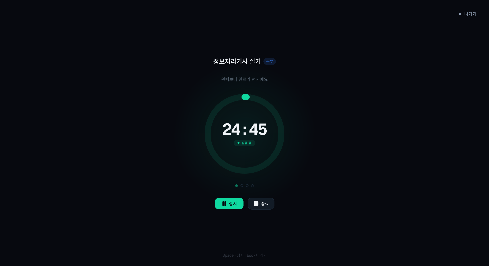
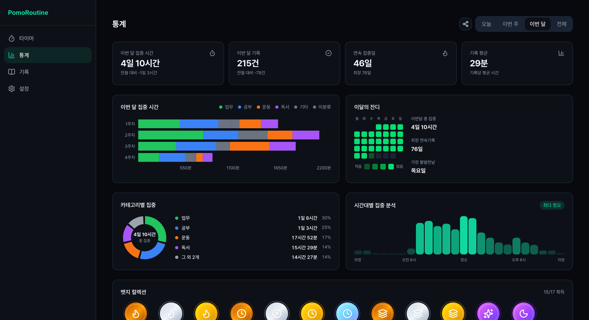

# PomoRoutine

[](https://pomoroutine.com) [](./LICENSE)

집중하고, 기록하고, 분석하는 포모도로 집중 도구

- 수험생과 취업 준비생을 위한 집중 타이머 → 회고 기록 → 통계 흐름
- 웹과 React Native 앱을 함께 개발, 한 계정으로 기기 간 기록 동기화
- 서비스 https://pomoroutine.com

<div align="center">
  
  
  
</div>

## 핵심 기능

| 기능 | 설명 |
|---|---|
| 포모도로 타이머 | 집중과 휴식 자동 전환, 고정 사이클 없는 자유 모드 |
| 집중 모드 | 타이머와 동기부여 메시지만 남긴 전체 화면 |
| 회고 기록 | 메모, 집중도, 방해 요소 태그, 집중 구간 타임라인 |
| 통계 | 기간별 집중 시간, 스트릭, 카테고리와 시간대 분석, 월간 히트맵 |
| 뱃지와 공유 카드 | 스트릭, 누적 시간, 다양성 뱃지 수집과 집중 요약 이미지 공유 |
| 비회원 체험 | 로그인 없이 타이머 바로 사용 |

## 기술적 의사결정

**웹과 모바일의 로직 공유**
- 타이머 상태 머신, 통계 집계, 뱃지 판정을 `packages/shared`로 공유
- 저장소만 주입 방식으로 분리 — 웹 localStorage, 앱 AsyncStorage

**하이브리드 앱 구조**
- 타이머와 설정은 네이티브, 통계와 기록 탭은 웹 화면을 WebView로 재사용
- 앱 로그인 상태를 WebView로 전달해 재로그인 불필요

**낙관적 업데이트**
- 작업, 카테고리, 기록의 수정과 삭제는 화면에 먼저 반영하고 실패하면 되돌림
- 추가는 저장이 끝난 뒤 실제 DB id로 캐시에 넣어 임시 id를 쓰지 않음
- 진행 중인 변경이 모두 끝난 뒤 한 번만 다시 조회해 늦게 온 응답이 화면을 덮어쓰지 않게 함 [#190](https://github.com/aaaz425/pomoroutine/pull/190)

**서버 집계와 이중 검증**
- 스트릭, 월간 히트맵처럼 전체 기록이 필요한 통계는 Postgres RPC에서 계산
- 모든 테이블에 RLS를 걸어 계정별 데이터 분리
- 입력 제한은 Zod와 DB CHECK에 같은 값으로 적용

## 트러블슈팅

**대시보드 성능 — 알고리즘이 아니라 데이터 흐름이 원인**
- 결과 — 통계 첫 진입 730ms → 302ms, 전송량 2.43MB → 32.1KB
- 문제 — 기록이 쌓일수록 통계 화면이 느려짐
- 1차 — Map 기반 O(n) 집계로 개선했지만 근본 해결 아님 [#114](https://github.com/aaaz425/pomoroutine/pull/114)
- 원인 — 클라이언트가 전체 기록을 받아 직접 집계하는 구조
- 해결 — 집계를 DB RPC로 이전 [#136](https://github.com/aaaz425/pomoroutine/pull/136), 남은 전체 기록 조회를 화면별 구간 조회로 교체 [#183](https://github.com/aaaz425/pomoroutine/pull/183) [#186](https://github.com/aaaz425/pomoroutine/pull/186) [#188](https://github.com/aaaz425/pomoroutine/pull/188)

전후 비교 — 기록 1만 건, Playwright 5회 중앙값

| 항목 | 전 | 후 |
|---|---|---|
| 흐름 전체 전송량 gzip | 2.43MB | 32.1KB |
| 통계 첫 진입 표시 | 730ms | 302ms |
| 통계 첫 진입 요청 완료 | 1,159ms | 318ms |
| 화면 복귀 후 재조회 | 1,176ms | 354ms |
| 전체 탭 전환 | 221ms | 59ms |

조회 방식 비교 — k6, 50회 중앙값

| 방식 | 100건 | 1천 건 | 1만 건 | 1만 건 응답 크기 |
|---|---|---|---|---|
| 전체 기록 조회 | 4.9ms | 9.7ms | 75.7ms | 8.4MB |
| RPC 요약 | 2.1ms | 4.3ms | 26.1ms | 4.6KB |

- 10명 동시 요청에서 RPC가 8배 빠름 — 중앙값 864ms → 102ms, 느린 5% 기준 2,165ms → 393ms
- 측정 방법은 [perf/README.md](perf/README.md)

**CI e2e 간헐 실패 — 테스트 코드가 아니라 실행 환경이 원인**
- 결과 — 간헐 실패 해소, CI 최대 3분 9초 → 2분 9초
- 확인 — 실패 시 trace를 남겨 타임아웃 동안 브라우저가 멈춘 것을 발견 [#151](https://github.com/aaaz425/pomoroutine/pull/151)
- 원인 — 같은 VM에서 dev 서버 HMR 컴파일이 브라우저와 CPU를 나눠 씀
- 해결 — e2e를 프로덕션 빌드로 실행 [#153](https://github.com/aaaz425/pomoroutine/pull/153)

## 기술 스택

| 영역 | 기술 |
|---|---|
| 웹 | Next.js 16 App Router, Tailwind CSS, shadcn/ui, Recharts, framer-motion |
| 앱 | React Native, Expo Router, react-native-reanimated, react-native-webview |
| 상태와 검증 | Zustand, TanStack Query, Zod |
| 백엔드 | Supabase Postgres, Auth, RLS, Edge Functions |
| 테스트 | Vitest, Playwright, GitHub Actions |
| 인프라 | pnpm workspace, Turborepo, Vercel |

## 문서

| 문서 | 내용 |
|---|---|
| [PRD](docs/specs/PRD.md) | 문제 정의, 타겟 사용자, 기능 범위 |
| [기능 명세](docs/specs/feature-spec.md) | 기능별 사용자 스토리와 주요 동작 |
| [화면 명세](docs/specs/screen-spec.md) | 화면 구성과 인터랙션 |
| [ERD](docs/specs/ERD.md) | 데이터 모델과 설계 이유 |
| [아키텍처](docs/specs/architecture-diagram.md) | 시스템 구조와 핵심 설계 결정 |
| [디자인 시스템](docs/guides/design.md) | 색상, 타이포, 컴포넌트 규칙 |

`CLAUDE.md`와 `docs/guides/`에는 AI 에이전트가 참고하는 개발 규칙을 따로 정리

## 로컬 실행

Node.js 22 이상, pnpm 11 이상 필요, 로컬 Supabase는 Docker 필요

```bash
pnpm install
pnpm dev                      # 웹 http://localhost:3000
pnpm --filter mobile start    # 앱 Expo 개발 서버
pnpm test                     # 단위 테스트
pnpm test:e2e                 # e2e 테스트
```

로컬 Supabase — `npx supabase start` 후 출력된 `API_URL`, `ANON_KEY`를 `apps/web/.env.local`에 입력

## 라이선스

[MIT](./LICENSE) © 2026
